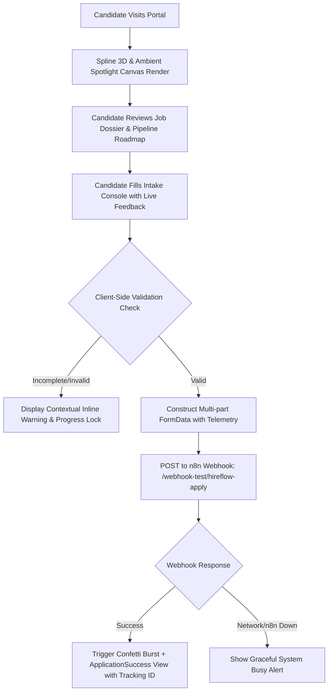

# HIREFLOW ATS - Complete Project Specification & State Index (`build.md`)

> **Single Source of Truth (SSOT)** for AI Agents and Developers.  
> *Engine: Next.js 16.1.1 (Turbopack) & React 19.2 | Type System: TypeScript 5.x*  
> *Design System: Obsidian Aerospace Glassmorphism (Tailwind v4 | DESIGN_VARIANCE: 7 | MOTION: 6 | DENSITY: 5)*  
> *Last Updated: October 2026 (Frontend Taste & Impeccable Design Overhaul Complete)*

---

## 1. Executive Summary & Core Mission
**HIREFLOW** is a state-of-the-art AI-Powered Candidate Intake Portal and Applicant Tracking System (ATS) frontend designed for high-conversion candidate submissions. Built with an aerospace obsidian aesthetic, it combines:
- **Interactive 3D Visuals & Lighting:** Ambient Spline 3D real-time canvas backdrop and SVG Spotlights for cinematic depth.
- **Dual-Column Aerospace Layout:** 12-column responsive grid pairing an exhaustive **Job Dossier & Pipeline Roadmap** (`lg:col-span-7`) alongside a high-precision **Candidate Intake Console** (`lg:col-span-5`).
- **Floating Telemetry Navbar:** Fixed glass header featuring real-time pipeline status, E2E encryption badges, and SLA response guarantees.
- **Tactile Candidate Intake Console:** Live 4-step progress indicator, inline validation indicators, localized 10-country phone length enforcement with live digit counters (`[N/maxLength]`), and interactive drag-drop resume dropzone with file preview & direct removal action.
- **Post-Submission Confirmation Hub:** Structured application receipt generator (`HF-2026-XXXXX`), copyable tracking code, candidate recap matrix, next-steps roadmap, and particle confetti celebrations.
- **Automated AI Pipeline Integration:** Seamless `FormData` dispatch to local/remote n8n webhook pipelines triggering Google Gemini extraction and Groq LPU scoring.

---

## 2. Architecture & 3-Layer System Design



### Complete Repository Map & Responsibilities
```
HIREFLOW Root
│
├── app/
│   ├── layout.tsx                     -> Root HTML shell, Geist font variables, ATS metadata & SEO tags
│   ├── globals.css                    -> Obsidian dark tokens, precision scrollbars, keyframe animations
│   └── page.tsx                       -> CandidatePortal: Dual-column aerospace layout orchestrating Dossier & Console
│
├── components/
│   └── ui/
│       ├── navbar.tsx                 -> Floating glassmorphic header with live telemetry & security badges
│       ├── job-dossier.tsx            -> Left-column role spec, mission scope, tech stack, and 4-step hiring roadmap
│       ├── candidate-form.tsx         -> Right-column intake console with live progress bar, phone formatting & dropzone
│       ├── application-success.tsx    -> Confirmation receipt with tracking reference ID, candidate recap & roadmap
│       ├── card.tsx                   -> Glassmorphic Card, CardHeader, CardContent container wrappers
│       ├── spline.tsx                 -> Lazy-loaded SplineScene with Suspense boundary
│       ├── spotlight.tsx              -> High-performance SVG blur spotlight backdrop
│       ├── glassmorphism-cta.tsx      -> Shimmer-bordered pill CTA button with rotating gradient & glow
│       └── glassmorphism-button.tsx   -> Reusable glassmorphic button for form submit & action triggers
│
├── lib/
│   ├── types.ts                       -> Extended TypeScript contracts (CountryConfig, JobDossier, SubmissionReceipt)
│   └── utils.ts                       -> Utility helpers (cn class merging with clsx + twMerge)
│
├── directives/                        -> Layer 1: SOPs & Operational Directives for AI Agents
│   ├── candidate_intake.md            -> Intake rules, boundary constraints, live progress & receipt protocols
│   ├── design_system.md              -> Aesthetic rules, dial values, palette locks, and component guidelines
│   ├── n8n_webhook_integration.md     -> Webhook contract, downstream AI parser, and retry strategies
│   ├── spline_3d_assets.md            -> Spline WebGL canvas runtime, positioning & fallback guidelines
│   └── maintain_build_spec.md         -> SOP for auto-updating build.md on every code modification
│
├── execution/                         -> Layer 3: Deterministic Execution Scripts
│   ├── validate_inputs.ts             -> Comprehensive test suite for 10-country phone lengths, email & receipts
│   └── verify_build_spec.ts           -> Integrity checker ensuring build.md matches codebase reality
│
├── .env.example                       -> Environment variable schema template
├── next.config.ts                     -> Turbopack workspace root resolution & Next.js config
├── tsconfig.json                      -> TypeScript paths (@/*) and compilation settings
├── package.json                       -> Project scripts and dependencies
└── eslint.config.mjs                  -> Next.js 16 core web vitals and TypeScript lint configuration
```

---

## 3. Tech Stack & Dependency Matrix

| Technology | Version | Purpose |
| :--- | :--- | :--- |
| **Next.js** | `16.1.1` (Turbopack) | App Router, Server/Client components, SSR & SSG |
| **React** | `19.2.3` | Core UI engine, React 19 concurrent features |
| **TypeScript** | `5.x` | Strict type safety and schema validation |
| **Tailwind CSS** | `4.x` | Modern styling engine with native `@theme` directives |
| **tw-animate-css** | `^1.x` | Extended animation utilities for Tailwind 4 |
| **lucide-react** | `^1.x` | Modern SVG iconography (`Send`, `Upload`, `FileText`, `Check`, `ShieldCheck`, etc.) |
| **@splinetool/react-spline** | `4.1.0` | Interactive 3D robot/space scene integration |
| **@splinetool/runtime** | `1.12.28` | WebGL runtime for Spline scenes |
| **canvas-confetti** | `1.9.4` | Particle celebration physics upon application receipt |
| **clsx & tailwind-merge** | `2.1.1` / `3.4.0` | Conflict-free conditional CSS utility concatenation |

---

## 4. Input Validation & Country Constraints Matrix

The portal implements strict localized phone length validation for 10 target countries (Top 5 Asian + Top 5 European tech hubs):

### Asian Markets
| Country | Code | Label | Flag | Max Length | Placeholder Format |
| :--- | :--- | :--- | :--- | :--- | :--- |
| **India** | `+91` | `IN (+91)` | 🇮🇳 | 10 digits | `98765 43210` |
| **China** | `+86` | `CN (+86)` | 🇨🇳 | 11 digits | `139 1234 5678` |
| **Japan** | `+81` | `JP (+81)` | 🇯🇵 | 10 digits | `90 1234 5678` |
| **Singapore** | `+65` | `SG (+65)` | 🇸🇬 | 8 digits | `8123 4567` |
| **UAE** | `+971` | `UAE (+971)` | 🇦🇪 | 9 digits | `50 123 4567` |

### European Markets
| Country | Code | Label | Flag | Max Length | Placeholder Format |
| :--- | :--- | :--- | :--- | :--- | :--- |
| **United Kingdom** | `+44` | `UK (+44)` | 🇬🇧 | 10 digits | `7700 900077` |
| **Germany** | `+49` | `DE (+49)` | 🇩🇪 | 11 digits | `151 23456789` |
| **Spain** | `+34` | `ES (+34)` | 🇪🇸 | 9 digits | `612 345 678` |
| **Italy** | `+39` | `IT (+39)` | 🇮🇹 | 10 digits | `312 345 6789` |
| **Netherlands** | `+31` | `NL (+31)` | 🇳🇱 | 9 digits | `6 12345678` |

### File Upload Constraints
- **PDF Resumes:** Max allowed size is **5,000,000 bytes (5MB)**. MIME: `application/pdf`.
- **Image Resumes (OCR):** Max allowed size is **1,000,000 bytes (1MB)**. MIME: `image/jpeg`, `image/png`.
- **Dropzone Feedback:** Live preview badge showing file name, formatted size in MB, and an instant **Remove** button.

---

## 5. Webhook Integration Contract

- **Endpoint URL:** `process.env.NEXT_PUBLIC_N8N_WEBHOOK_URL || "http://localhost:5678/webhook-test/hireflow-apply"`
- **HTTP Method:** `POST`
- **Body Payload (`multipart/form-data`):**
  - `name`: Candidate full legal name (String)
  - `phone`: Country code + phone number (String, e.g. `+91 9876543210`)
  - `email`: Validated email address (String)
  - `resume`: Binary file payload (`File` object)

---

## 6. Design System & Frontend Taste Directives
- **Palette Lock:** Dark obsidian background (`#07080d`), translucent glass surfaces (`bg-black/40` with `backdrop-blur-xl`), hairline border accents (`border-white/10`), electric blue primary brand focus (`#3b82f6`), and emerald status elements (`#10b981`).
- **Anti-Slop Directives:** Zero purple gradient clichés. No generic centered hero containers. Rich dual-column balance ensuring both role transparency and frictionless applicant intake.
- **Micro-Interactions:** Conic shimmer border sweeps, live progress percentage transitions, tactile button active states, and celebratory confetti bursts.

---

## 7. Optimization & Verification Log
1. **Design Read Applied:** Elevated from a bare centered input box into an aerospace-grade candidate intake portal.
2. **Dual-Column Architecture:** Integrated `JobDossier` and `CandidateForm` side-by-side with sticky positioning on desktop and clean mobile stacking.
3. **Telemetry & Trust:** Added floating `Navbar` with live pipeline status, encryption assurances, and 48-hour response SLA.
4. **Enhanced Feedback:** Added 4-step progress calculation, live digit counters, and single-click resume discard action.
5. **Tracking Receipt:** Generated unique candidate reference codes with one-click clipboard copy.
6. **Deterministic Verification:** 18 validation assertions and build specification verification scripts passing with 0 warnings.
7. **Type Safety:** 100% strict TypeScript compilation with `npx tsc --noEmit`.
